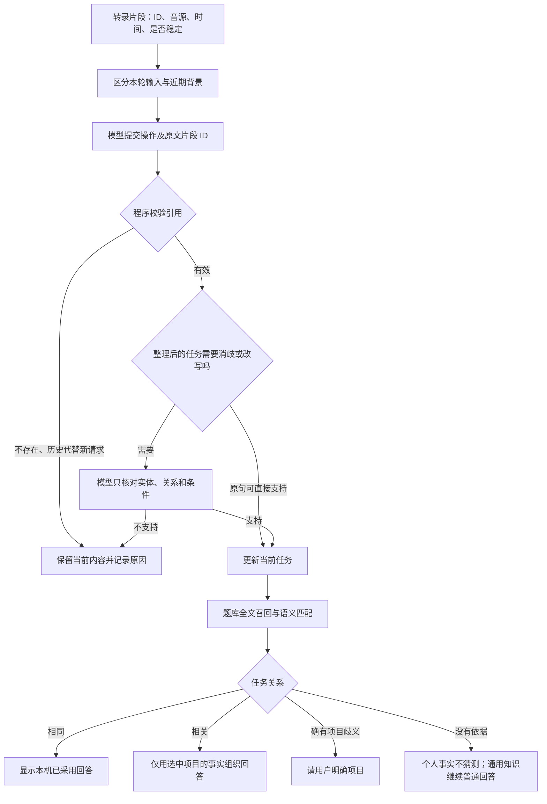

# 问题提取与题库检索：实现和验证

## 处理顺序



## 原文依据由程序读取

窗口内每段保留独立 ID。本轮与历史背景分别标记，音源只是角色线索。在线系统音频是主要问题来源，麦克风发言只用于背景；单音轨测试需要模型结合语义区分双方。

模型通过 `submit_task` 选择四种操作之一：回答、等待、重复、自我介绍。引用使用 `evidence_ids` 和 `context_ids`，候选 ID 也写入函数参数 Schema 的枚举。程序从窗口读取对应原文，校验当前请求不能只引用历史片段。模型不负责重新抄写含噪原句。

整理后的任务涉及指代消解或语义改写时，`verify_task` 仅检查实体、主体客体、位置、否定、比较对象与条件是否有原文支持。该步骤不再重复判断角色和是否存在新请求。

同一批内即使后面开始了回答，任务来源也取真正请求的片段 ID，而非批次最后一段。更新同一来源时沿用现有稳定性规则。仅标点、空格或大小写变化不会重新生成回答；数学运算符保留为任务的一部分。

每批最多两次模型请求。等待和重复只需一次；可直接由原句支持的任务无需额外核验。原有最小调用间隔和音频停顿调度保留，不增加定时轮询。线上触发仍只看系统音频能量，麦克风不会触发线上判别。

## API 协议

DeepSeek 与兼容 API 使用 Chat Completions 原生函数调用，指定函数名；Ollama 使用原生 Schema 结构化输出。复用现有接口、模型和 Windows 凭据管理器，不引入独立 Agent 服务或额外模型配置。

这两个环节需要兼容服务支持 Tool Calling。连接检测在当前需要结构化接口时执行一个不含个人资料的协议探测。仅支持普通聊天的服务不能据此认定支持题库匹配。

函数调用使用 [DeepSeek 官方协议](https://api-docs.deepseek.com/guides/tool_calls/)。普通 DeepSeek 接口不宣称提供 Beta strict 模式保证。程序仍检查函数名、参数、允许的操作、引用范围、截断状态和结果数量。格式有效不等于内容一定正确，含义核验仍存在模型误差。失败不自动发起付费修复请求。

## 题库的混合检索

1. 从当前保存文件读取启用状态，仅使用已采用且引用仍有效的题目。
2. 规范化后与题目、别名严格相同时可直接使用本机回答；数学关系不会被当作普通标点忽略。
3. 标题/别名/标签/项目的字面相似度，与问题、任务、回答和展开内容的 BM25 排名通过 RRF 融合。近期对话为低权重背景。
4. API 的 `match_questions` 结合当前任务、近期对话和候选目录判断任务关系。出现多个项目候选不会提前终止匹配。
5. 程序检查返回 ID 必须属于本轮候选，相关条目必须属于同一项目。相同任务只选一题；相关任务最多选五题，并在回答前重新验证保存版本和引用。

当前候选规模：不超过 128 题时给语义匹配完整目录，使零字面重合的口语问法也有机会命中；更大题库使用融合排名的前 32 题。题库本身不限制为 100 题。目录只含标题、别名、项目、任务、分类；标准答案与原资料不随目录发送。目录稳定排序并放在请求前部，使内容不变时的前缀保持一致，便于服务端缓存；实际命中量以接口返回的用量为准。

`same` 才直接复用；`related` 只提供部分依据，需要按最新要求组织回答；`ambiguous` 才提示项目歧义。新限制或个人贡献问题不会仅因为提到同一项目而被判为相同任务。

未命中时，由同一次语义调用的 `needs_personal_evidence` 判断回答是否需要本人经历或项目事实。通用原理题继续普通回答，需要个人事实而没有依据时提示补充资料。该分支不使用“你”“项目”等词的正则表达式判断问题类型。只有资料段落而没有已采用题目时，也先判断这一项，再决定是否需要资料背景。

这是全文召回与模型语义匹配的组合。当前没有新增向量 Embedding 服务；较大题库仍可能因本地候选召回不足而漏掉纯语义相似题，不能宣称等同于已完成向量检索评测。

## 资料发送与历史

每次语义匹配的发送范围需要确认。相关条目要作为回答背景发送时，再确认问答与资料片段的实际范围。完整命中的标准回答从本机读取。不会自动采用草稿或改写标准回答。

历史新增识别和检索依据，默认收起。查询时可勾选“显示问题识别和题库检索依据”，查看本轮窗口、原文 ID、模型提议、核验结果、候选 ID、命中关系和错误。阶段用量分别记录。历史仍不保存原始音频。

## 验证方式

本地门禁：

```powershell
npm run build
node --test evaluation/task-window.test.mjs evaluation/knowledge-routing.test.mjs evaluation/decision-scheduler.test.mjs evaluation/decision-stability.test.mjs evaluation/dialogue-context.test.mjs evaluation/history.test.mjs
node --test evaluation/dual-context.test.mjs evaluation/knowledge-ui.test.mjs
cargo test --manifest-path src-tauri/Cargo.toml --lib
```

本地 Ollama 可通过 `evaluation/semantic-dialogue.smoke.py` 运行合成输入，直接复用 Rust 的生产协议、解析和校验。脚本不再通过字符串查找抓取生产提示词。

真实会话输入与 API 返回放在忽略的 `outputs/` 中。`cached_dialogue_replay` 使用已保存模型结果验证本机状态与引用处理，不调用网络。它不等同于模型重新推理。

付费回放 `approved_dialogue_replay` 默认忽略，必须提供已明确同意的输入文件、完全一致的 SHA-256 和全新的结果路径。每次请求先写入请求账本，再发送；达到本轮预算或发生接口错误时停止，不自动重发。不能以换结果文件名的方式绕过用户的本轮发送授权。

真实历史只有最终转录，缺少原始音频及完整增量时序。因此，抽取窗口回放只能验证已保存文字到任务和检索的行为；不能据此宣称端到端语音准确率或实际面试总体命中率。
