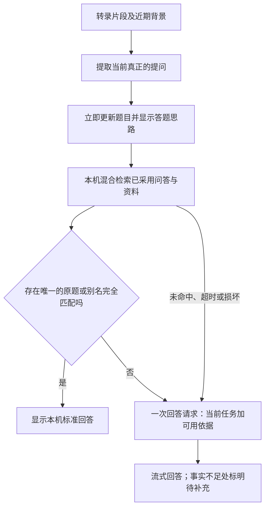

# 问题提取与回答依据：1.0.33

## 处理顺序

问题提取只判断谁在问什么，不判断题库里有没有答案。角色、当前片段引用、重复和停止状态的校验继续有效。题库启用状态、项目歧义和资料不足都不能成为不提取问题的理由。

## 术语与原文

原始转录保留片段 ID、音源和时间。模型通过 `submit_task` 提交新任务及引用 ID，程序取回原文，禁止历史发言代替当前请求。近期语境、岗位与主题可辅助理解追问。

启用资料后，程序从已采用题目的标题、别名、标签，以及可用资料的相对文件名中抽取术语候选；最多48项、800字符，不发送标准回答或源码来辅助识别。该词表同时供提取与改写含义核验使用，只能辅助音近消歧，不能创造经历或改变关系。没有词表或本地资料不可读时，仍执行普通识别。不确定的术语由回答阶段说明采用的理解。

DeepSeek/兼容 API 的语音问题识别继续使用原生 Tool Calling，Ollama 使用 Schema。每批至多提取与核验两次调用，保留原有音频停顿及调用间隔，不增加轮询。线上仍只由系统音频触发，麦克风只提供背景。

## 统一检索增强回答

运行时不再调用 `match_questions` 判断 same/related/new/ambiguous 后决定能否回答。此前的目录语义匹配协议保留用于旧回放记录，不再位于正常回答路径。

本机从当前保存文件读取已采用且引用有效的问答；题目、别名、标签和项目的相似度，与问答全文的 BM25 排名通过 RRF 融合。原题或别名完全一致且唯一时可直接显示本机标准回答；其他问法直接进入回答生成，无需额外的 API 匹配请求。

回答上下文最多5道问答与5段资料，限制总大小。保留领先的相关条目，同时为其他项目预留候选位置；项目名称随每项依据保留，概述/比较允许跨项目，不能把一个项目的成果移给另一个。优先项目只辅助排序，不排除其他项目；问题明确指定一个项目时才缩小对应的事实范围。它不是开始回答的前置设置。

候选只提供参考，回答模型根据最新任务选用事实。通用技术问题可直接使用通用知识，不因没有个人项目依据而拒答；经历题结合简历原文与已采用答案，缺少个人事实时给具体组织思路并注明待补充。没有资料不等于没有任何可提供的提示，也不意味着可以编造个人经历。

本地检索最多等待1.2秒。未命中、多个项目、全文索引损坏或读取超时，均继续回答。发送前重新验证候选问答及资料；若已被修改或失效，丢弃这些依据并继续普通生成。底层 API 不可用时仍保留本机答题思路并显示连接错误，不能保证离线生成具体知识答案。

当前使用全文检索，没有新增向量服务。相近问法可由回答模型结合候选资料处理，但本地召回仍可能遗漏语义相关内容，不能承诺百分之百命中或事实正确。

## 自动发送与历史

启用题库后，相关问答及资料的运行时使用已获授权；关闭即可停用题库增强。回答请求发送当前任务、近期问题、相关依据及已填写的必要背景。手动分析、建库保留范围预览，草稿不会自动采用，标准答案不会被生成结果改写。

历史记录原始转录、整理后的问题、本机召回条目、降级原因和模型用量。识别/检索依据默认收起。历史不保存原始音频。

## 验证边界

测试覆盖普通技术问题、经历与开放问题、跨项目概述、准确原题、无匹配、未采用/失效问答、损坏索引、读取超时、连续新题与迟到旧结果。模型内容验证与界面路由验证分别记录；用缓存判断做本地回放不代表模型重新推理或整场音频准确率。
