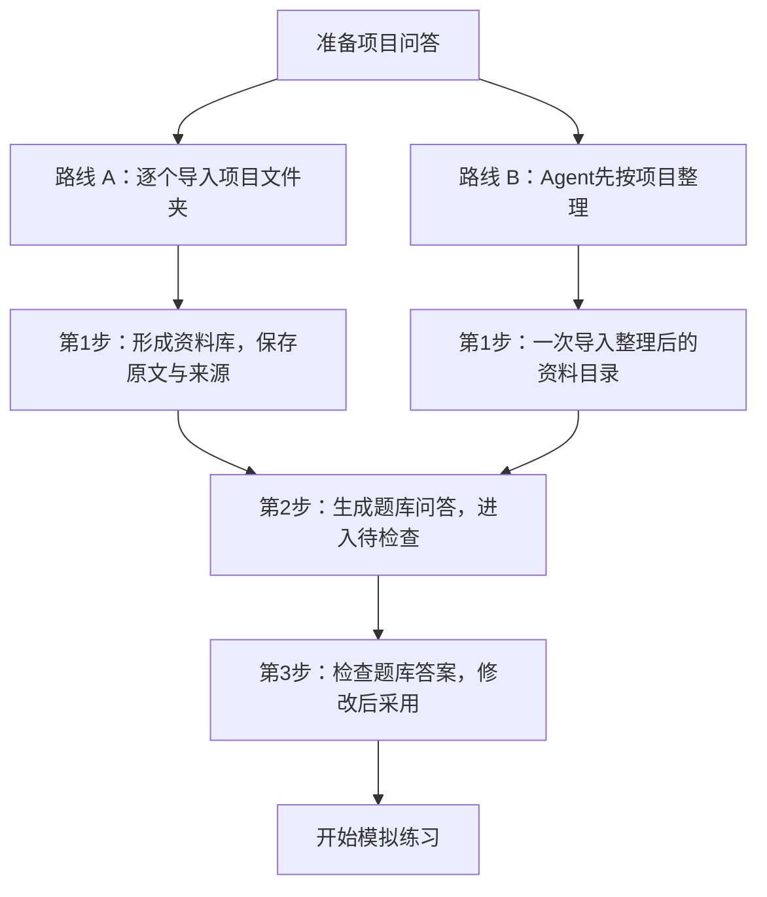

# 面试准备：先选一条资料路线

先在“设置 → 模型与服务”连接生成模型。使用 API 不需要 Ollama。

资料库保存原文、代码和来源，题库保存可编辑的问答。下面第1步整理资料库，第2、3步整理题库。



## 路线 A：逐个导入项目

适合已有各项目文件夹的情况。一次选一个项目；文件名、内部层级不限，可以混放文档、报告、幻灯片和代码子目录，不需要先转成TXT。

```text
项目 A/                 ← 选择这个目录
├─ 项目说明.docx
├─ 技术方案.pptx
├─ 测试报告.pdf
└─ 代码/train.py
```

1. 到“面试准备 → 资料”，点击“导入项目文件夹”。默认使用文件夹名作为项目名，也可以先填项目名。
2. 继续导入下一个项目，直到资料准备齐。代码、报告等子目录都归到所属项目，不需要逐文件分类。
3. 简历或跨项目背景可命名为“共享资料”导入。

## 路线 B：Agent整理后，一次导入

适合资料比较零散，且电脑上有能读写文件的 Agent 的情况。

1. 在顶部“使用指南”的路线B点击“复制Agent整理说明”（“资料”页也可复制），把说明、原资料位置和新输出位置交给 Agent。
2. Agent只读原件，转换可读取内容，并按下面的结构整理。
3. 点击“导入Agent整理目录”，选择其中的“资料”目录。

```text
新输出目录/
├─ 资料/                 ← 软件选择这个目录
│  ├─ 项目 A/            ← 原文、代码与必要来源定位
│  ├─ 项目 B/
│  └─ 共享资料/          ← 如简历、跨项目背景
├─ 整理说明/             ← Agent的解释与项目导读
└─ 处理说明.md
```

原文与Agent的解释分开保存。扫描件或旧格式需要Agent具备OCR或转换能力；无法处理的应说明原因。

这份说明用于整理资料，不会直接生成题库。导入前阅读“处理说明.md”，确认项目划分、遗漏项和待核实内容；不能只凭Agent说“已完成”判断所有文件都处理正确。

## 两条路线都支持哪些文件

直接读取DOCX、PPTX、XLSX、ODT/ODP/ODS、带文字层的PDF，TXT/Markdown、CSV、JSON/YAML等文本，以及Python、C/C++、Java、JS/TS、Rust等源码。单个文件不超过64 MiB；文本建议UTF-8。读取资料不依赖Ollama，后续API生成问答可能计费。

扫描PDF、图片、图表和公式不能保证完整提取；旧DOC/PPT/XLS和WPS原生文件先转换。音视频、模型权重及二进制文件不作为原文读取。仅提供相关材料，排除密钥、依赖、缓存和大型原始数据；导入后查看失败或遗漏提示。项目代码只读，不会执行。

## 两条路线后面都一样

1. 资料库准备好后，点击“准备问答”生成题库草稿。默认处理全部已导入项目，可在顶部限制项目或文件范围。API发送前预览范围和请求次数，确认后才处理，可能计费。使用已配置的本地生成模型时，流程相同。
2. 到“待检查”展开题库答案，核对实际贡献、完成情况和原文引用。有误就编辑，核对后采用。修改答案不会改动资料库的原文。
3. 到“已采用”开启使用，在模拟练习设置勾选“使用已采用问答出题”，设置范围、时长和难度后开始。

已有待检查问答时，可以直接检查；有新资料再补充。软件自动保存，原文件不会修改。生成模型可能出错，保存修改不会自动替换已采用答案。

## 其他功能按需使用

新增、查找、编辑和删除在“待检查 / 已采用”中操作。已有问答导入、Agent直接建题、备份和资料更新放在下方的其他功能或文件列表中。它们不是首次使用的必经步骤。

打开设置、面试准备或问答编辑时，拖动顶部标题栏的非按钮区域即可移动整个软件窗口；输入框和正文用于正常编辑、选择或滚动。
